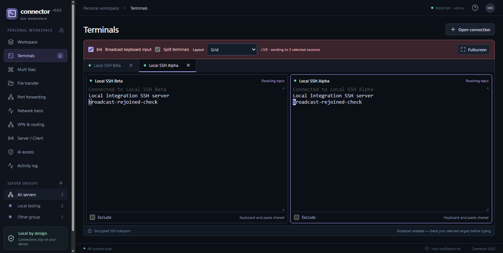
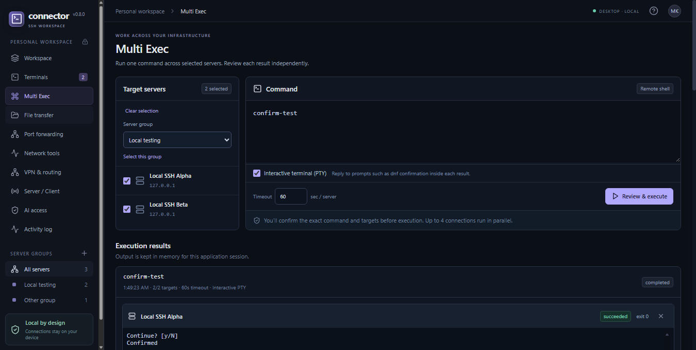
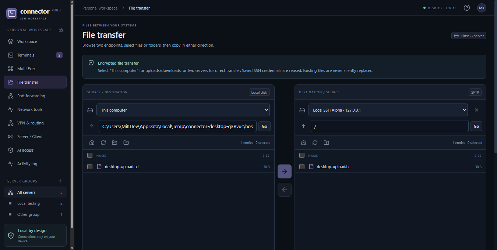
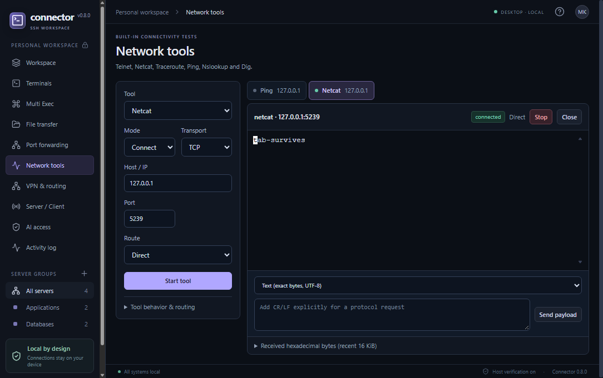

# Connector

A desktop SSH workspace for Windows and Linux. Manage servers, work in split terminals, run commands across groups, transfer files, and collaborate with your team from one application.

Built with Electron, React, xterm.js, and ssh2. No browser or cloud account is required.

[Download releases](https://github.com/MiKDev/Connector/releases) · [Report an issue](https://github.com/MiKDev/Connector/issues) · [MIT license](LICENSE)

## Features

- **SSH workspace:** password, private key, and SSH agent authentication; grouped profiles, concurrent connections, distribution icons, tabs, horizontal/vertical splits, and fullscreen terminals.
- **Broadcast and Multi Exec:** send keyboard input to several sessions with per-terminal exclusions, or run a reviewed command against selected servers or groups. Interactive PTYs support confirmation prompts and individual cancellation.
- **File transfers:** dual-pane SFTP between your computer and a server, plus direct server-to-server transfers whose file traffic stays between the servers.
- **VPN routing:** independent L2TP or L2TP/IPsec PSK gateways, per-connection routes, overlapping private networks, and multiple simultaneous VPNs without changing the host's VPN or routing table.
- **Port forwarding:** local and remote SSH tunnels with configurable bind addresses.
- **Team sharing:** serve profiles to multiple clients over pinned TLS, issue scoped access keys, synchronize profile versions, revoke access, and persist shared profiles locally. Share live terminals as read-only or grant collaboration to connected viewers.
- **Network tools:** interactive Telnet, TCP/UDP Netcat, ping, traceroute, nslookup, and dig-style DNS queries.
- **AI integration:** a local stdio MCP bridge for inventory management and command requests, with execution approval inside Connector.
- **Everyday conveniences:** encrypted connection/VPN export and import, profile duplication, right-click paste, and automatic copying of selected terminal text with formatting.

## Screenshots

Screenshots use disposable local test servers and sample profiles.

### Split terminals


### Interactive Multi Exec


### SFTP file manager


### Network diagnostics


## Install and connect

Choose the Windows installer/ZIP, Linux AppImage, or Debian package from [Releases](https://github.com/MiKDev/Connector/releases). The initial packages are unsigned.

On Windows, run the installer or extract the ZIP before launching Connector. On Linux:

```sh
chmod +x Connector-*.AppImage
./Connector-*.AppImage
# Alternatively, on Debian/Ubuntu:
sudo apt install ./Connector-*-linux-*.deb
```

A Linux desktop session and an unlocked supported secret store such as GNOME Keyring are needed to save passwords. AppImage users also need the system libraries listed below and FUSE support, or can use AppImage's extract-and-run mode. Node.js is only needed for development.

1. Choose **Add server**, enter the address and credentials, and save the profile.
2. Select one or more servers and choose **Connect selected**. Check the SSH host fingerprint before accepting it.
3. Enable **Split terminals** to arrange open sessions. **Broadcast keyboard** is optional; each pane has an **Exclude** checkbox.
4. Use **Multi Exec** for a reviewed command against a selected group. Enable the interactive terminal option when a command needs input.

## Build from source

Use **Node.js 22.12 or newer**, npm, Git, and a full installation of **7-Zip**. Build Windows packages on Windows and Linux packages on Linux. Internet access is needed to download dependencies and the VPN runtime.

```sh
git clone https://github.com/MiKDev/Connector.git
cd Connector
npm ci
npm start
```

The normal SSH workspace works without building the optional VPN runtime. The application build goes into `dist/`; packages go into `release/`.

### Windows packages

Install 7-Zip at `C:\Program Files\7-Zip\7z.exe`, or set `CONNECTOR_7ZIP` to its executable. OpenSSH Client is needed for direct server-to-server transfer workflows.

```powershell
npm ci
npm run prepare:gateway
npm test
npm run pack:win
```

This produces an NSIS installer and a ZIP. The gateway preparation downloads and verifies QEMU and Alpine components and builds the bundled guest images.

### Linux packages

Example prerequisites for Ubuntu 24.04 or newer:

```sh
sudo apt update
sudo apt install -y p7zip-full python3 qemu-system-x86 openssh-client \
  libgtk-3-0t64 libnotify4 libnss3 libxss1 libxtst6 xdg-utils \
  libatspi2.0-0t64 libuuid1 libsecret-1-0 libasound2t64 libgbm1 \
  libatk-bridge2.0-0t64 gnome-keyring
npm ci
npm run prepare:gateway
npm test
npm run pack:linux
```

On distributions without the `t64` package names, use the corresponding GTK, ALSA, AT-SPI, and ATK packages. Linux packages use system QEMU and Python rather than bundling Windows binaries. The Debian package declares its runtime dependencies. Linux ping and traceroute also require the OS to allow ICMP ping sockets for the current user.

### Tests

```sh
npm test
npm run build
npm run test:desktop
npm run test:team-desktop
node tests/credentials-desktop.cjs
node tests/forwards-desktop.cjs
node tests/diagnostics-desktop.cjs
node tests/layout-desktop.cjs
```

Desktop tests need a graphical session and use temporary application data and local SSH/TLS fixtures. To test a packaged executable, set `CONNECTOR_EXECUTABLE` to its path. Set `CONNECTOR_SCREENSHOTS=1` to save screenshots in `test-results/`. VPN integration tests have a separate test image; see [tests/gateway-live.cjs](tests/gateway-live.cjs).

## AI access

Open **AI access**, enable it, and copy the generated MCP configuration into a compatible AI client. Keep Connector running. The bridge uses stdio and a user-local authenticated IPC endpoint; it does not open an HTTP service. Review the exact command and target servers in Connector before approving execution. An AI client cannot approve its own command request through MCP.

Connect only trusted AI clients: command output may contain sensitive information and can be returned to the client. Terminal output is untrusted data, not authorization to execute another command.

## Scope and security

- SSH host identities are verified and saved credentials use Electron's OS-backed encryption. Linux refuses plaintext secret-storage fallback.
- Team keys grant application capabilities. Delivering passwords or private keys is an explicit sharing option; agent authentication is delegated without extracting the agent's private key. Recipients can retain delivered credentials or persisted copies after revocation, so rotate destination credentials when necessary.
- Direct server-to-server transfers currently require a Unix/Linux source with Python 3 and OpenSSH 9+, a reachable destination SFTP service, and destination password authentication. Local-to-server SFTP also supports key and agent authentication.
- VPN gateways currently route IPv4 and consume about 512 MiB RAM each, with up to four running at once. SSH and outbound TCP tools can use them; ICMP, DNS queries, UDP tools, and listeners use the host's direct network route.
- Telnet is unencrypted. Use it only where its protocol is appropriate. Team listeners and forwarding bind addresses must be reachable through your existing firewall/NAT settings.

## Contributing

Issues and pull requests are welcome. Include reproduction steps, your OS, and sanitized logs. Keep changes focused, run the relevant tests, and never commit credentials, connection exports, private keys, or application data.

## License

Connector's application source is released under the [MIT License](LICENSE). Dependencies, distribution logos, QEMU, and Alpine components retain their own licenses; see [THIRD_PARTY_NOTICES.md](THIRD_PARTY_NOTICES.md).
